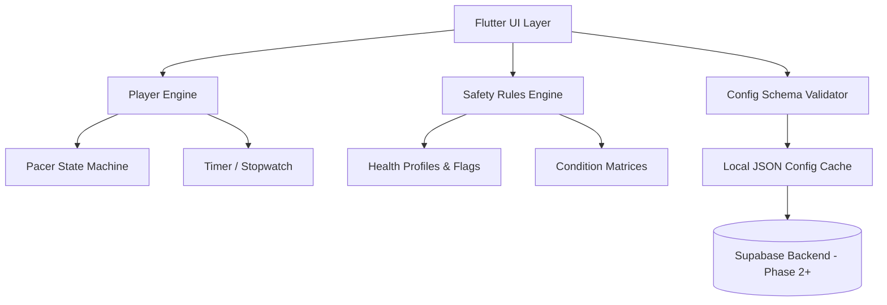

# Architecture

The system is designed with offline-first capabilities for mobile using Flutter, with decoupled internal layers to easily handle business logic, practice timers, and backend syncing later.

## High-Level Diagram



## Flutter Application Structure

```text
/app/lib
  /core        theme (tokens), l10n, routing, haptics, audio, clock
  /engine      player_engine (pure Dart), safety_rules, config_models
  /features
    /onboarding
    /today
    /practice   (list, preflight, player, checkin, cycle_composer)
    /dhyan      (mala, nidra)
    /path       (path_map, level_detail, unlock_request)
    /library
    /me         (progress, health, weaning, settings)
  /widgets     shared components
  /data        repositories, local db (offline), sync
```

## Layers

1. **Engine Layer** (`app/lib/engine`)
    - **Config Schema Validator**: Validates incoming remote configurations against our predefined schema.
    - **Safety Rules Engine**: Evaluates the user's current health screening flags (e.g., pregnancy, hypertension) and decides if a practice can be unlocked. Includes rule-matrix unit tests.
    - **Player Engine**: Manages practice session states and computes maximum allowed durations for breath holds using the logic: `min(level_cap, user_CHT * hold_cap_fraction)`.

2. **Features Layer** (`app/lib/features`)
    - Contains all the UI screens decoupled by domain (e.g., dhyan, practice, onboarding). The UI layer **only renders state from the engine**; it never computes holds, caps, or locks itself.

3. **Widgets Layer** (`app/lib/widgets`)
    - Reusable, stateless UI components implementing the Design Tokens. Examples: `StopButton`, `PhasePill`, `LockBadge`.

4. **Offline Storage & Backend** (`app/lib/data`)
    - Caches configurations, synced states, and session logs locally (e.g. `shared_preferences`, SQLite), uploading when the network resumes.
