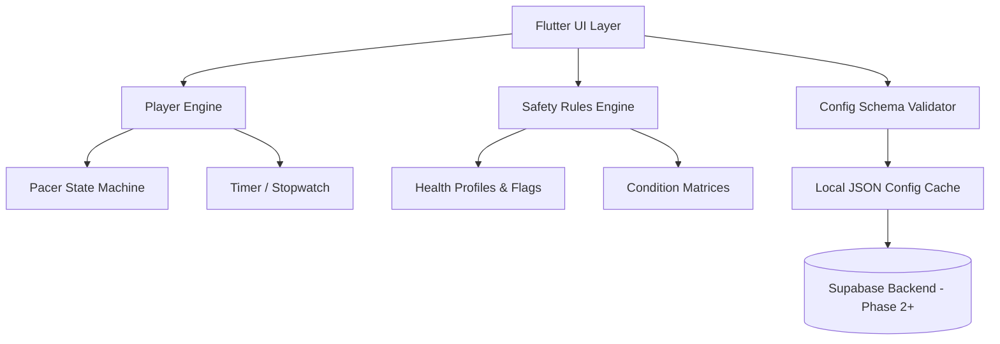

# Architecture

The system is designed with offline-first capabilities for mobile using Flutter, with decoupled internal layers to easily handle business logic, practice timers, and backend syncing later.

## High-Level Diagram

## Layers

1. **Config Schema Validator** (`app/lib/config/config_validator.dart`)
    - Validates incoming remote configurations against our predefined schema.
    - Rejects invalid configurations and logs to the Teacher Console (via backend).

2. **Safety Rules Engine** (`app/lib/safety/safety_rules_engine.dart`)
    - Pure Dart logic.
    - Evaluates the user's current health screening flags (e.g., pregnancy, hypertension) and decides if a practice can be unlocked.
    - Includes rules for regression based on "strain" feedback from previous sessions.
    - Exposes a robust matrix of unit tests.

3. **Player Engine** (`app/lib/player/player_engine.dart`)
    - Manages practice session states.
    - Computes maximum allowed durations for breath holds using the logic: `min(level_cap, user_CHT * hold_cap_fraction)`.
    - Coordinates UI visual updates, haptic feedbacks, and audio cues independent of UI thread via streams or state objects.

4. **Offline Storage & Backend** (To be implemented)
    - Will cache configurations, synced states, session logs locally in SQLite or similar, uploading when network resumes.
